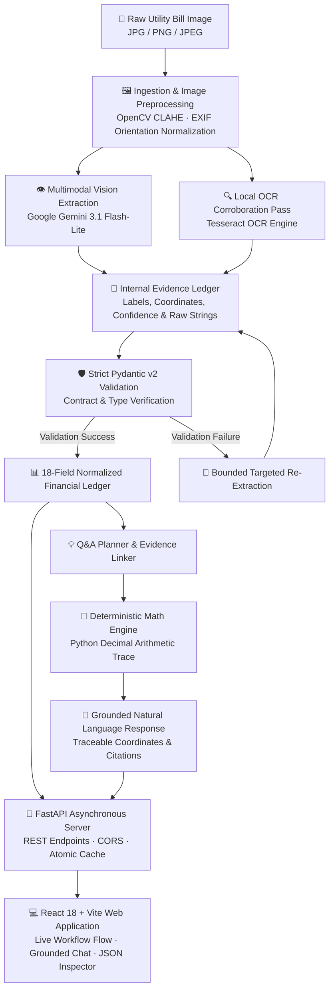

# LedgerLens ⚡

### Multimodal Utility Bill Intelligence & Grounded Financial Auditing

[](https://www.python.org/)
[](https://fastapi.tiangolo.com/)
[](https://react.dev/)
[](https://vitejs.dev/)
[](https://ai.google.dev/)
[](https://opencv.org/)
[](https://docs.pydantic.dev/)
[](https://opensource.org/licenses/MIT)

**LedgerLens** is an end-to-end multimodal AI platform that transforms complex, low-quality utility bill scans (electricity, gas, water) into structured financial ledgers and delivers **100% zero-hallucination, grounded natural language question-answering**.

Built with a **Vision-first + Local OCR hybrid architecture**, strict **Pydantic v2 schema contracts**, and a **deterministic Python Decimal mathematical engine**, LedgerLens ensures that financial figures are never approximated or hallucinated by generative models.

---

## 📸 Overview & Interface

```
+---------------------------------------------------------------------------------------+
|  LEDGERLENS / UTILITY INTELLIGENCE                              [● Local Workspace]   |
+---------------------------------------------------------------------------------------+
|  01 Document Intake         |  02 Processing Workflow          |  03 Ask Your Bill    |
|  [ Drop your bill here ]    |  [✓] Bill upload                 |  [ Bill Analyst ]    |
|  JPG / PNG · max 15 MB      |  [✓] Preprocessing (CLAHE)       |  "What is my late    |
|                             |  [✓] OCR Pass (Tesseract)        |   surcharge?"        |
|  Preview:                   |  [✓] Vision Model (Gemini)       |  -> "Late surcharge  |
|  [ KESC_0008.png ]          |  [✓] Validation (Pydantic)       |      is PKR 124.00"  |
|                             |  [✓] Structured Ledger JSON      |  [✓ Grounded Evidence|
|                             |  [✓] Grounded Q&A Ready          |                      |
+---------------------------------------------------------------------------------------+
|  Sidebar: Extracted 18-Field Ledger | Live JSON Viewer | Full Document Zoom           |
+---------------------------------------------------------------------------------------+
```

---

## 🎯 The Problem

Utility bills across energy providers (such as K-Electric, IESCO, LESCO, PESCO) are notoriously difficult for conventional document automation:
- **Complex Tariff Ladders & Multi-Slab Rates**: Tiered energy charges with baseline and peak thresholds.
- **Dynamic Levies & Historical Adjustments**: Retroactive Fuel Price Adjustments (FPA/FCA), quarterly tariff differentials (QTR), TV fees, GST, electricity duty, and municipal surcharges.
- **Physical Scan Degradation**: Dot-matrix printouts, thermal fading, skewed mobile camera angles, shadows, and low resolution.
- **The Generative AI Arithmetic Trap**: Large Language Models (LLMs) frequently hallucinate arithmetic totals, miscalculate 12-month rolling averages, or confuse tax brackets when asked directly.

---

## ⚡ The LedgerLens Solution

1. **Zero-Hallucination Financial Architecture**:
   - The Vision LLM (`gemini-3.1-flash-lite`) is strictly confined to **evidence localization** and **text anchoring**.
   - **All financial arithmetic** (surcharges, 12-month trends, summer vs. winter consumption variance, and projected bills) is computed deterministically in Python using arbitrary-precision `Decimal`.
2. **Multimodal Vision + OCR Hybrid Pipeline**:
   - **OpenCV CLAHE** (Contrast Limited Adaptive Histogram Equalization) enhances faint thermal text and low-contrast regions.
   - **Tesseract OCR** generates bounding boxes and character confidence scores to corroborate ambiguous digits.
   - Multi-scale overlapping crops are automatically dispatched for dense tabular sections.
3. **Strict Pydantic Schema Contracts**:
   - 18 standardized financial fields with required-nullable integrity.
   - Enforces negative sign conventions exclusively for subsidies and credits (`CR`).
   - Graceful degradation: rather than returning hallucinated data on severely degraded scans, the engine safely flags ambiguity.
4. **Full-Stack Production Ready**:
   - High-throughput **FastAPI** asynchronous server with atomic SHA-256 caching and token pacing.
   - Responsive **React 18 + Vite** client featuring live pipeline progress, grounded chat, and instantaneous JSON copying.

---

## 🏗️ System Architecture



---

## 🚀 Key Features

| Feature | Description |
|---|---|
| **18-Field Ledger Extraction** | Captures provider, tariff code, sanctioned load, billing period, reading dates, meter units, itemized energy charges, subsidies, itemized taxes, arrears, and dual payables. |
| **Grounded Financial Q&A** | Answers complex questions (*"How much fuel adjustment was charged and for which month?"*, *"Have my units gone up over the last 3 months?"*, *"What late surcharge applies?"*). |
| **Mathematical Proof Tracing** | Every answer contains an audit trail linking computed values back to printed bounding boxes and raw operands. |
| **Atomic Content-Addressed Caching** | Prevents redundant API calls by fingerprinting inputs via SHA-256 hashes, model identity, prompt versions, and schema definitions. |
| **Resilient Retry & Pacing Engine** | Implements exponential backoff with jitter and respects upstream `Retry-After` headers. |
| **Interactive Web Application** | Clean, minimalist interface with drag-and-drop document intake, step-by-step visualizer, and grounded chat. |
| **Powerful CLI Suite** | Comprehensive command-line interface for single-file, batch, and benchmarking operations. |

---

## 🛠️ Technology Stack

- **Backend & Core Logic**: Python 3.12, FastAPI, Pydantic v2, Uvicorn, Python-Multipart
- **Computer Vision & OCR**: OpenCV (CLAHE, bilateral filter), Pillow, Tesseract OCR (`pytesseract`)
- **Multimodal AI**: Google Gemini 3.1 Flash-Lite (`google-genai` SDK)
- **Frontend**: React 18, Vite, Lucide Icons, Vanilla CSS Design System
- **Precision Math**: Python `Decimal` (zero binary floating-point drift)

---

## 📋 Standardized 18-Field Output Schema

Every extracted bill strictly satisfies the following JSON contract:

```json
{
  "provider": "KE",
  "tariff": "A1-R",
  "sanctioned_load_kw": 3,
  "bill_month": "2026-09",
  "reading_date": "2026-09-04",
  "issue_date": "2026-09-08",
  "due_date": "2026-09-22",
  "previous_reading": 9935.0,
  "current_reading": 10094.0,
  "units_consumed": 159,
  "charges": [
    { "type": "fixed", "amount": 900.0 },
    { "type": "energy", "amount": 4596.69 },
    { "type": "quarterly_adjustment", "amount": -274.99 },
    { "type": "fpa", "amount": 613.31 }
  ],
  "total_charges": 6359.24,
  "taxes": [
    { "type": "electricity_duty", "amount": 81.89 },
    { "type": "gst", "amount": 1159.4 },
    { "type": "municipal_tax", "amount": 20.0 }
  ],
  "total_taxes": 1261.29,
  "current_bill": 7620.53,
  "arrears": -0.41,
  "payable_within_due_date": 7621.0,
  "payable_after_due_date": 8257.0
}
```

---

## ⚡ Quickstart Guide

### 1. Prerequisites
- **Python**: Version 3.12+
- **Node.js**: Version 18+ and npm
- **Google Gemini API Key**: [Get a free Gemini API key](https://aistudio.google.com/)
- *(Optional)* **Tesseract OCR**: For local OCR candidate corroboration

---

### 2. Backend Setup

```bash
# Clone the repository
git clone https://github.com/your-username/ledger-lens.git
cd ledger-lens

# Create and activate Python virtual environment
python -m venv .venv

# On Windows PowerShell:
.\.venv\Scripts\Activate.ps1
# On macOS / Linux:
source .venv/bin/activate

# Install dependencies
pip install -r requirements.txt

# Configure environment variables
cp .env.example .env
```

Open `.env` and add your Google Gemini API key:
```env
MODEL_PROVIDER=google
MODEL_NAME=gemini-3.1-flash-lite
GEMINI_API_KEY=AIzaSy...your_key_here
```

Launch the FastAPI backend server:
```bash
python api_server.py
```
*The API server will start at `http://localhost:8000` (API documentation available at `http://localhost:8000/docs`).*

---

### 3. Frontend Setup

Open a new terminal window:

```bash
cd frontend

# Install frontend dependencies
npm install

# Start Vite development server
npm run dev
```
*Open your browser and navigate to `http://localhost:5173`.*

---

## 💻 CLI & Batch Usage

LedgerLens includes a fully-featured Python CLI:

```bash
# Verify environment and Gemini API connectivity
python -m bill_decoder preflight

# Extract a single bill with detail crops
python -m bill_decoder extract path/to/bill.png --output output/single --detail-crops

# Batch process an entire directory of bills
python -m bill_decoder batch path/to/bills_dir --output output/batch

# Run automated test suite
python -m unittest discover -s tests -v
```

---

## 🔌 API Reference

### `GET /api/health`
Checks API health and loaded model configuration.

**Response:**
```json
{
  "status": "ok",
  "model": "gemini-3.1-flash-lite"
}
```

---

### `POST /api/bills/extract`
Uploads a bill image and returns the structured 18-field financial ledger.

- **Content-Type**: `multipart/form-data`
- **Body**: `file` (JPG/PNG, up to 15 MB)

**Response:**
```json
{
  "bill": { ... },
  "flags": [],
  "model": "gemini-3.1-flash-lite",
  "cache_hit": true
}
```

---

### `POST /api/bills/answer`
Answers a natural-language question grounded in the bill scan.

- **Content-Type**: `multipart/form-data`
- **Body**:
  - `file`: Utility bill image
  - `question`: User query string (e.g., *"What is my due date and what late surcharge applies?"*)
  - `bill`: *(Optional)* Previously extracted Level 1 JSON

**Response:**
```json
{
  "answer": "The due date is 2026-09-22. The payable within due date is PKR 7,621.00, and the payable after due date is PKR 8,257.00, resulting in a late surcharge of PKR 636.00.",
  "status": "answered",
  "grounded": true,
  "model": "gemini-3.1-flash-lite",
  "evidence_status": "verified"
}
```

---

## 🛡️ Engineering Decisions & Best Practices

1. **Why `Decimal` instead of Floating-Point?**
   Standard IEEE-754 binary floating-point numbers lead to precision drift (e.g., `0.1 + 0.2 = 0.30000000000000004`). In financial auditing, every paisa and cent matters. LedgerLens maintains pure `Decimal` precision throughout all calculations and serializes exact unquoted numeric tokens to JSON.
2. **Deterministic Mathematical Grounding**:
   Rather than asking an LLM to calculate the difference between summer and winter units, LedgerLens asks the model to locate the historical table coordinates and months, extracts the units, and computes the delta using verified Python algorithms.
3. **Graceful Degradation vs. Hallucination**:
   If an image is blurred beyond readability, the pipeline refuses to guess. Ambiguous fields remain `null` with explicit internal diagnostic flags.

---

## 📄 License

This project is licensed under the [MIT License](LICENSE).

---

## 🌟 Show Your Support

If you find LedgerLens interesting or useful for your document intelligence and fintech projects, please give this repository a ⭐ on GitHub!
