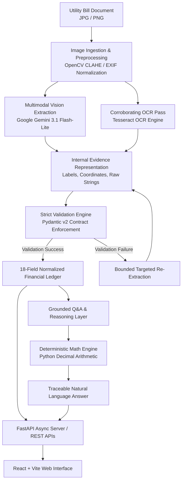

# LedgerLens — System Architecture & Technical Specifications

**LedgerLens** is an enterprise-grade, multimodal AI pipeline designed for digitizing complex utility bills, enforcing strict accounting schema integrity, and answering natural-language financial queries without numerical hallucination.

---

## 1. High-Level Architecture Overview

---

## 2. Core Architectural Principles

### 2.1 Zero-Hallucination Deterministic Financial Math
Large Language Models (LLMs) are inherently probabilistic and unreliable at precise arithmetic calculations (e.g., compound tax percentages, 12-month moving averages, fuel surcharge adjustments, or slab comparisons).
- **Rule of Separation**: The vision LLM is strictly restricted to *evidence extraction* and *citation gathering*.
- **Execution**: All calculations (aggregations, seasonal unit variance, late surcharges, and unit projections) are executed by a pure Python `Decimal` calculation engine.
- Every calculated answer is backed by an auditable calculation trace including operands, operations, and source coordinate references.

### 2.2 Dual-Layer Multimodal Vision + Local OCR
Utility bills in complex grid markets (e.g., K-Electric, IESCO, LESCO) frequently suffer from poor contrast, thermal ink fade, matrix dot printers, and non-standard grid layouts.
- **Visual Preprocessing**: Contrast Limited Adaptive Histogram Equalization (CLAHE), bilateral noise reduction, and EXIF orientation normalization.
- **Multimodal LLM**: Processes the overall spatial layout, semantic sections, and complex multi-column billing tables.
- **Local OCR Corroboration**: Tesseract OCR generates candidate bounding boxes and character-level confidence scores to cross-verify low-confidence digits.

### 2.3 Strict Pydantic Schema Contracts
Data is validated against strict Pydantic v2 models:
- All required fields must be present (or explicitly validated as `None` if missing on the printed bill).
- Disallows silent type coercions (e.g., strings as numbers, booleans as integers).
- Negative values are strictly reserved for subsidies and credits (`CR`).
- Reject malformed records rather than polluting downstream ledgers with hallucinations.

---

## 3. Module Breakdown

| Module | Responsibility |
|---|---|
| `bill_decoder.images` | Image decoding, EXIF rotation correction, OpenCV CLAHE contrast enhancement, detail crops. |
| `bill_decoder.ocr` | Local Tesseract OCR interface, bounding box mapping, and character confidence extraction. |
| `bill_decoder.engine` | Orchestrates multimodal LLM extraction with schema validation and bounded retry loops. |
| `bill_decoder.schema` | Pydantic data models for Level 1 bill records, charges, taxes, and raw Decimal representations. |
| `bill_decoder.calculations` | Deterministic computation engine for Level 2 queries (averages, seasonal deltas, surcharges). |
| `bill_decoder.qa` | Grounded Q&A planner: pairs user questions with verified facts and computed math. |
| `api_server.py` | Asynchronous FastAPI service exposing extraction and question-answering endpoints with CORS. |
| `frontend/` | Modern React 18 + Vite web client featuring live pipeline step visualization and grounded chat. |

---

## 4. Caching & Fault Tolerance

- **Atomic Content-Addressed Caching**: Cache keys are derived from SHA-256 hashes of the source image combined with model ID, schema version, and prompt versioning.
- **Rate-Limiting & Backoff**: Built-in exponential backoff with jitter and `Retry-After` adherence to protect against upstream API throttling.
- **Safe Structured Logging**: Diagnostics record structured status and execution metrics without ever exposing sensitive credentials, API keys, or raw PII.
